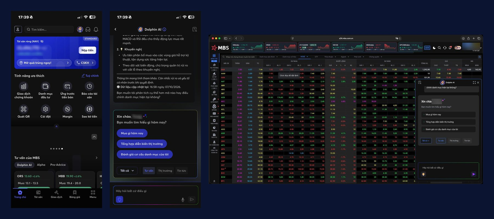
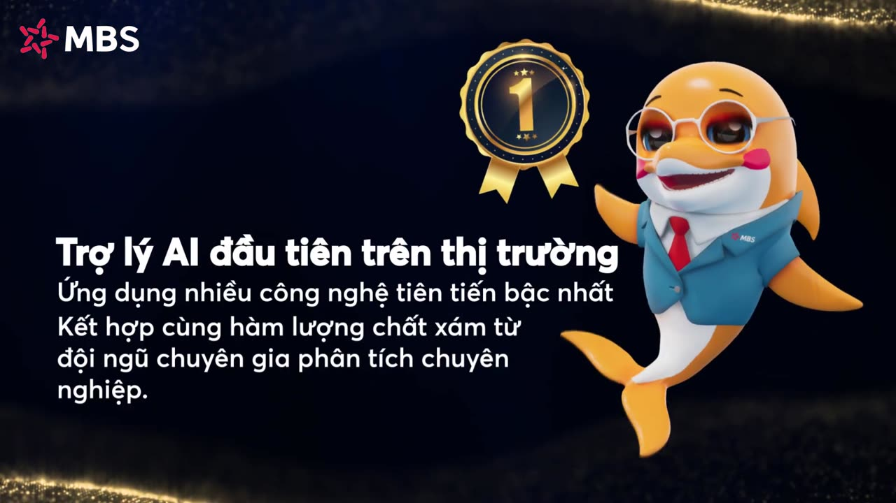
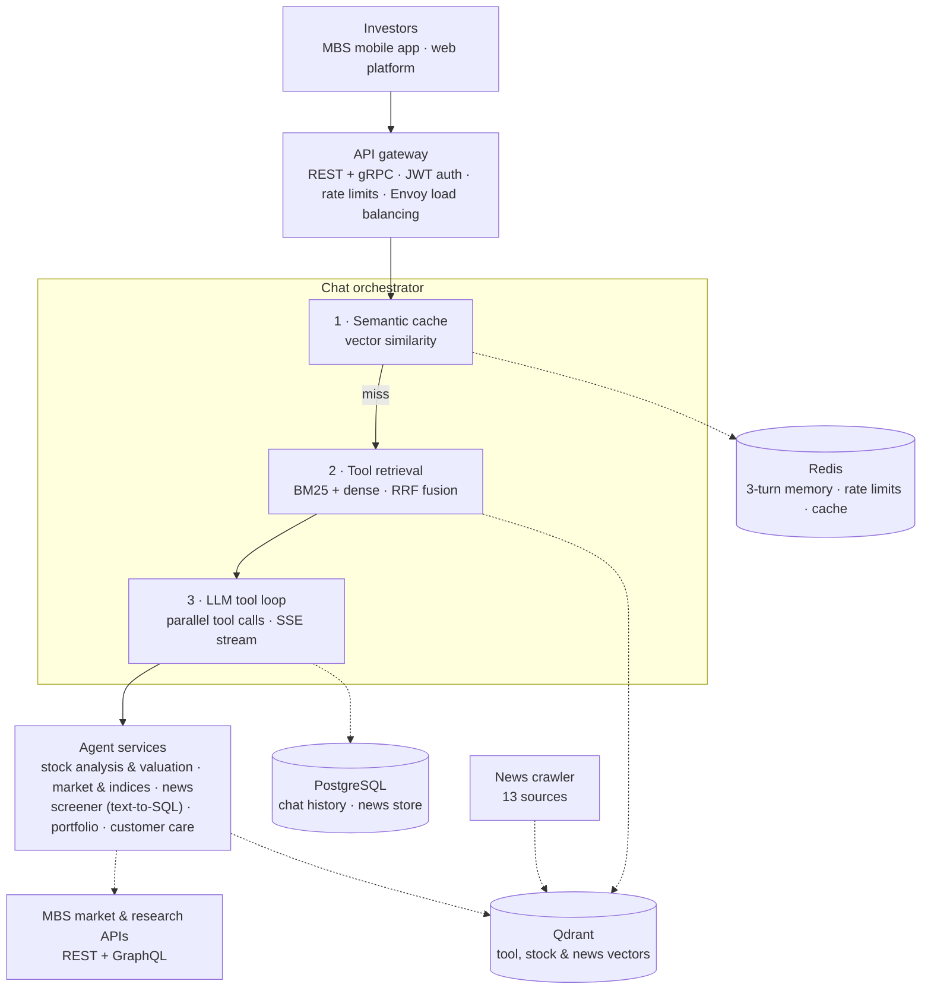
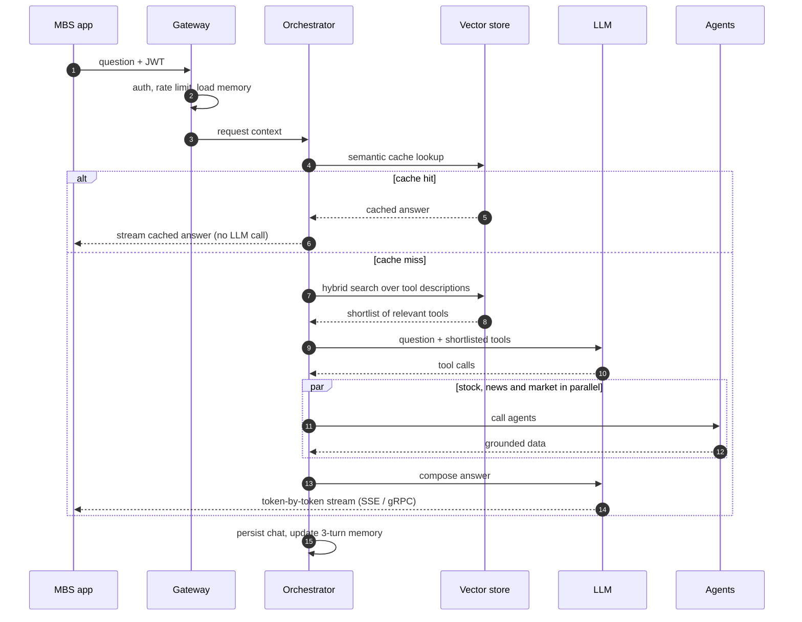
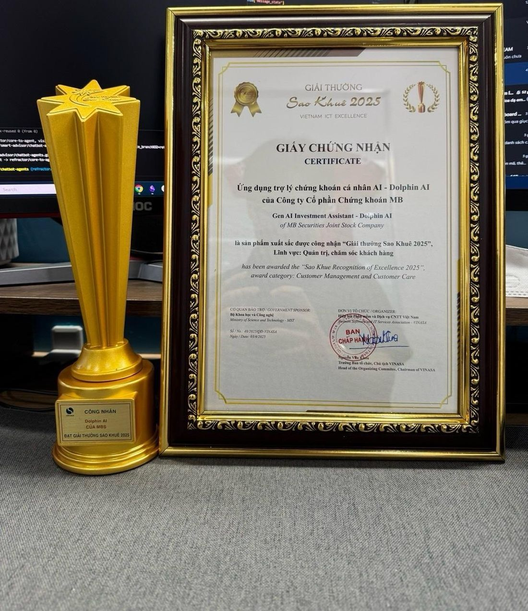

# DolphinAI: a production multi-agent assistant for retail investors

**MB Securities (MBS), Hanoi · Sep 2024 – Jul 2026 · Lead AI architect, agent core**

DolphinAI is the AI investment assistant inside the MBS mobile app and web platform. It launched on 14 February 2025 and had answered **2.5 million questions as of February 2026**, with **50,000 users per month**. I led the AI architecture, built the multi-agent core, and owned the AI side of a 15-person product team.

> The source code belongs to MB Securities and is not public. This repository documents the architecture, the decisions behind it and the results, at the level I can share. Internal service names, endpoints, schemas and credentials are left out.

*DolphinAI in the MBS mobile app (left) and docked beside the live price board on the web platform (right). Customer names and balances are blurred.*

*Launch film by MBS (88 s, Vietnamese). Click to watch on YouTube.*

## Results

| Metric | Result |
|---|---|
| Questions answered | **2.5M** as of Feb 2026, 50,000 users per month |
| Transactions referencing DolphinAI | **4,300 bn VND (~AUD 230M)**, as at Dec 2025 |
| Concurrency | **8 → 3,000+** concurrent users (375×) on high-computation services |
| Latency | **99.999%** of production queries returned in under 15 s (JMeter-verified) |
| Grounding | **97.2%** of responses grounded in MBS proprietary knowledge |
| Cost | **8× lower** projected system cost by building in-house instead of licensing |
| Business | Contributed to a **10%** rise in MBS's digital-channel market share |
| Recognition | **Sao Khue 2025** award, Customer Management & Customer Care |

## The problem

Retail investors in Vietnam wanted fast answers about stocks, the market and their own portfolios. MBS had the research, the market data and the analysts, but no way to put that knowledge in front of tens of thousands of investors at once, in plain Vietnamese, around the clock, with answers that reflect MBS's own view.

## Architecture

### One request, end to end

## Decisions that shaped it

**1. Build the agent stack in-house.** Licensing an external agent platform was an option. I made the case for our own framework and built it: it kept customer data in house, kept costs predictable, and cut projected system cost by 8×.

**2. Choose tools by retrieval, not by prompt.** The LLM never sees every tool. A hybrid search (BM25 for exact tickers and terms, dense vectors for meaning, merged with reciprocal rank fusion) shortlists the few tools that fit the question. Fewer tools in context means fewer tokens, fewer wrong calls, and new agents can ship without touching orchestration.

**3. A reusable agent framework.** Every agent is defined, routed and tested the same way, with shared state objects that record each tool call and LLM call with token counts and timings. That made the suite of production agents consistent and debuggable.

**4. Ground every answer in MBS data.** Agents answer from MBS research, market data and normalised news, not from the model's memory. A distributed crawler keeps 13 reputable news sources flowing into the vector store. 97.2% of responses are grounded in proprietary MBS knowledge.

**5. Serve repeats from a semantic cache.** On a busy market day many investors ask nearly the same thing. Near-duplicate questions are matched in a vector cache and streamed straight back, with no LLM or tool calls.

**6. Stream every token.** Server-Sent Events over REST and streaming gRPC, so the answer starts forming while agents are still working.

**7. Load-test before launch.** Async service design behind Envoy load balancing, verified with JMeter: from 8 to more than 3,000 concurrent users, with 99.999% of queries under 15 seconds.

## What I built

- The in-house multi-agent system and the reusable agent framework
- The production agent suite and its routing logic
- RAG over MBS market data and research, and the distributed crawling pipeline
- RESTful and gRPC APIs: authentication, rate limiting, database integration, embedding services, unit tests
- SSE streaming for token-by-token responses
- The scaling work: async services, Envoy load balancing, JMeter load tests

## Stack

Python (asyncio) · FastAPI · gRPC · OpenAI Responses API · Qdrant (hybrid dense + sparse) · Redis / RedisVL · PostgreSQL · Text-Embeddings-Inference · Envoy Proxy · JMeter · Scrapy

## Recognition and press

- [MBS launches DolphinAI](https://vietstock.vn/2025/02/mbs-tien-phong-ra-mat-dolphin-ai-tro-ly-thong-minh-uu-viet-cho-ndt-chung-khoan-144-1275427.htm), Vietstock, Feb 2025 (Vietnamese)
- [DolphinAI at Sao Khue 2025](https://www.vinasa.org.vn/vinasa/4/3076/4213/18878/Tin-chuyen-nganh/ChatGPT--Grok-danh-gia-nhu-the-nao-ve-Dolphin-AI---Chatbot-Chung-khoan-duy-nhat-duoc-vinh-danh-tai-Sao-Khue-2025.aspx), VINASA, Apr 2025 (Vietnamese)
- [MBS accelerates with technology, data and AI](https://cafef.vn/nang-hang-mo-cuoc-dua-moi-mbs-tang-toc-bang-cong-nghe-du-lieu-va-ai-188261004153758078.chn), CafeF, Oct 2026 (Vietnamese)
- [DolphinAI product page](https://www.mbs.com.vn/dolphin/), MBS

---

**Duc Quang (Cillian) Nguyen** · AI Engineer, Sydney · [Portfolio](https://quangcodecode.github.io) · [LinkedIn](https://www.linkedin.com/in/duc-quang-ng) · [dquangforwork@gmail.com](mailto:dquangforwork@gmail.com) · +61 422 475 168
